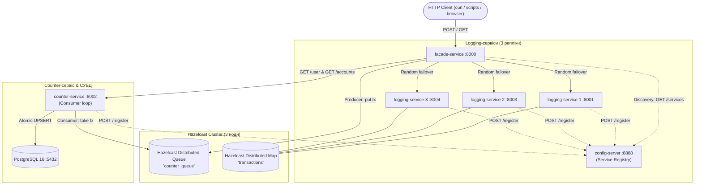

# Лабораторна робота 4 — Мікросервіси з використанням Messaging Queue та Config Server

**Виконав:** Габунія А.П.

Цей проєкт є подальшим розвитком мікросервісної банківської архітектури.
У даній лабораторній роботі:
1. **Асинхронна черга повідомлень (Messaging Queue):**
   - Оновлення рахунків у `counter-service` тепер відбувається асинхронно через **Hazelcast Distributed Queue** (`counter_queue`).
   - `facade-service` виступає у ролі **Producer**: при отриманні POST-запиту він кладе повідомлення в чергу і миттєво відповідає клієнту, не чекаючи на повільні дискові операції СУБД.
   - `counter-service` виступає у ролі **Consumer**: у фоновому режимі вичитує транзакції з черги та застосовує їх до PostgreSQL.
2. **Сервер конфігурації (Config Server / Service Discovery):**
   - Розгорнуто `config-server` (порт 8888), який веде динамічний реєстр активних IP-адрес мікросервісів.
   - Кожен сервіс (`logging-service-1..3`, `counter-service`) при запуску реєструє себе через `POST /register`.
   - `facade-service` перед відправкою запитів динамічно запитує адреси у `config-server`.
3. **Відмовостійкість при недоступності `counter-service`:**
   - Якщо `counter-service` зупинено або поставлено на паузу (`docker pause counter-service`), клієнтські POST-запити продовжують успішно прийматися, а транзакції накопичуються в черзі Hazelcast.
   - Після відновлення (`docker unpause counter-service`) черга автоматично вичитується без втрати жодної транзакції.

---

## Архітектура системи



---

## Структура директорії `lab4`

```text
lab4/
├── docker-compose.yml              # Опис усіх 10 сервісів
├── Task_4-Microservices_with_MessageQueue.md
├── README.md
├── hazelcast/
│   └── hazelcast.yaml              # Конфігурація Hazelcast кластера та черги counter_queue
├── config-server/
│   ├── app.py                      # Реєстр адрес сервісів
│   ├── Dockerfile
│   └── requirements.txt
├── facade-service/
│   ├── app.py                      # Producer для черги, інтеграція з config-server
│   ├── Dockerfile
│   └── requirements.txt
├── logging-service/
│   ├── app.py                      # Збереження в Hazelcast IMap + реєстрація в config-server
│   ├── Dockerfile
│   └── requirements.txt
├── counter-service/
│   ├── app.py                      # Consumer черги повідомлень + PostgreSQL + реєстрація
│   ├── Dockerfile
│   └── requirements.txt
└── load-test/
    ├── demo_10_transactions.py     # Демонстрація 10 транзакцій
    ├── test_mq_fault_tolerance.py  # Тест відмовостійкості (docker pause counter-service)
    └── requirements.txt
```

---

## Інструкція з запуску

### 1. Запуск усієї системи через Docker Compose:
```powershell
cd lab4
docker-compose up --build
```

### 2. Демо 10 транзакцій:
```powershell
python load-test/demo_10_transactions.py
```

### 3. Перевірка відмовостійкості черги повідомлень (docker pause):
```powershell
python load-test/test_mq_fault_tolerance.py --docker
```

---

## Вимоги до репозиторію GitHub

Код розміщено у гілці **`micro_mq`**:
```bash
git checkout -b micro_mq
git add .
git commit -m "Implement Lab 4: Microservices with Messaging Queue (Hazelcast Queue) and Config Server"
git push origin micro_mq
```
