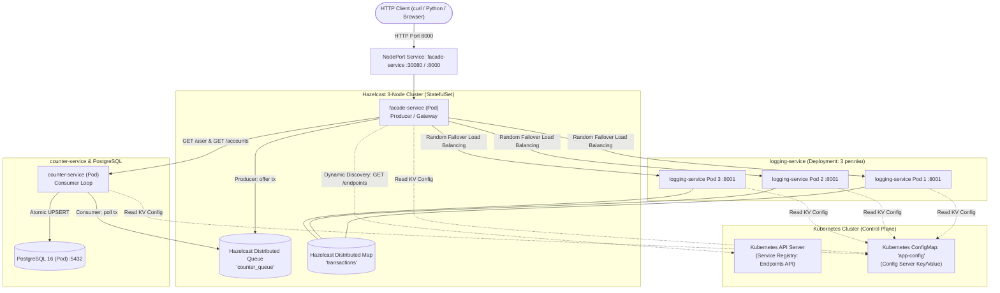

# Лабораторна робота 5 — Мікросервіси з використанням Kubernetes як Service Discovery та Config Server

**Виконав:** Габунія А.П.  
**Гілка репозиторію:** `micro-kubernetes`

---

## Опис лабораторної роботи

Цей проєкт є фінальним етапом розвитку розподіленої мікросервісної банківської архітектури.  
У лабораторній роботі №5 систему переведено на оркестрацію **Kubernetes (K8s)**, який виконує ролі:
1. **Service Registry та Dynamic Service Discovery:**
   - Кожен мікросервіс (`facade-service`, `logging-service`, `counter-service`) розгортається у Kubernetes як керований Deployment/StatefulSet.
   - Екземпляри сервісів динамічно реєструються у внутрішньому реєстрі Kubernetes (`Endpoints` / `EndpointSlices`).
   - `facade-service` звертається до **Kubernetes Endpoints API**, отримує актуальні IP-адреси та порти живих Pod-ів і виконує випадкове балансування навантаження між 3-ма репліками `logging-service`.
   - Жодних статичних або захардкодних IP-адрес у коді чи конфігураціях немає.
2. **Config Server (Key/Value сховище):**
   - Налаштування кластера Hazelcast (`HAZELCAST_CLUSTER_NAME`, `HAZELCAST_CLUSTER_MEMBERS`) та черги повідомлень (`HAZELCAST_QUEUE_NAME`), а також параметри підключення до бази даних зберігаються централізовано у **Kubernetes ConfigMap** (`app-config`).
   - Сервіси зчитують конфігурацію автоматично при старті.
3. **Автоматична відмовостійкість і динамічне масштабування (Fault Tolerance & Scaling):**
   - При масштабуванні або аварійному вимкненні Pod-а (`kubectl scale deployment logging-service --replicas=1` або падінні контейнера) Kubernetes миттєво оновлює `Endpoints`, а `facade-service` перенаправляє запити виключно на працездатні Pod-и без жодної помилки для користувача.
   - При недоступності `counter-service` (`kubectl scale deployment counter-service --replicas=0`) операції поповнення та списання (**POST**) продовжують прийматися та надійно накопичуються в асинхронній черзі **Hazelcast Queue**.
   - Читання балансу (**GET**) повертає `null` (`counter_available: false`).
   - Після повернення `counter-service` (`replicas=1`) сервіс вичитує всі накопичені повідомлення з черги та оновлює стан рахунків у PostgreSQL.

---

## Архітектура системи в Kubernetes



---

## Структура каталогу `lab5`

```text
lab5/
├── k8s/                                # Усі маніфести Kubernetes
│   ├── 00-namespace.yaml               # Namespace 'bank-system'
│   ├── 01-rbac.yaml                    # ServiceAccount, Role, RoleBinding для читання Endpoints
│   ├── 02-configmap.yaml               # ConfigMap 'app-config' (Config Server KV)
│   ├── 03-postgres.yaml                # PostgreSQL Deployment + Service
│   ├── 04-hazelcast.yaml               # 3-Node Hazelcast StatefulSet + Headless Service
│   ├── 05-logging-service.yaml         # Logging Deployment (3 replicas) + Service
│   ├── 06-counter-service.yaml         # Counter Deployment + Service
│   ├── 07-facade-service.yaml          # Facade Deployment + NodePort Service
│   └── k8s-all-in-one.yaml             # Повний зведений маніфест в одному файлі
├── facade-service/
│   ├── app.py                          # K8s Dynamic Discovery, Producer черги, метрики
│   ├── Dockerfile
│   └── requirements.txt
├── logging-service/
│   ├── app.py                          # Hazelcast IMap + K8s ConfigMap KV
│   ├── Dockerfile
│   └── requirements.txt
├── counter-service/
│   ├── app.py                          # MQ Consumer + PostgreSQL + K8s ConfigMap KV
│   ├── Dockerfile
│   └── requirements.txt
├── hazelcast/
│   └── hazelcast.yaml                  # Конфігурація черги counter_queue та кластера
├── load-test/
│   ├── benchmark.py                    # Порівняльний бенчмарк продуктивності
│   ├── demo_10_transactions.py         # Демо 10 транзакцій та перевірка балансів
│   ├── test_k8s_fault_tolerance.py     # Тест масштабування та відмовостійкості K8s
│   └── requirements.txt
├── docker-compose.yml                  # Локальний запуск для тестування без K8s
├── Task_5-Microservices_with_Kubernetes.md
└── README.md
```

---

## Інструкція із запуску в Kubernetes

### 1. Збірка образів мікросервісів у Docker:
```powershell
docker build -t facade-service:k8s ./facade-service
docker build -t logging-service:k8s ./logging-service
docker build -t counter-service:k8s ./counter-service
```
*(Якщо використовується Minikube: перед збіркою виконайте `minikube -p minikube docker-env | Invoke-Expression`)*.

### 2. Розгортання всіх ресурсів у Kubernetes:
```powershell
kubectl apply -f k8s/k8s-all-in-one.yaml
```

### 3. Перевірка статусу Pod-ів:
```powershell
kubectl get pods -n bank-system -o wide
```
*Усі Pod-и мають перейти у статус `Running`:*
* `facade-service-...` (1/1)
* `logging-service-...` (3 Pod-и, по 1/1 кожен)
* `counter-service-...` (1/1)
* `hazelcast-0`, `hazelcast-1`, `hazelcast-2` (3 Pod-и)
* `postgres-...` (1/1)

### 4. Прокидання порту до facade-service:
```powershell
kubectl port-forward svc/facade-service 8000:8000 -n bank-system
```
Після цього фасад доступний локально за адресою `http://localhost:8000`.

---

## Перевірка функціональності та запуск тестів

### Крок 1. Перевірка реєстрації та динамічного Discovery у Kubernetes
Відкрийте в браузері або виконайте в PowerShell:
```powershell
Invoke-RestMethod -Uri "http://localhost:8000/discovery"
```
*Ви отримаєте JSON із переліком зареєстрованих Pod-ів:*
```json
{
  "service_registry": "Kubernetes Endpoints API (K8s Service Discovery)",
  "config_server": "Kubernetes ConfigMap (app-config)",
  "in_cluster_api_connected": true,
  "discovered_logging_pods": [
    "http://10.244.0.12:8001",
    "http://10.244.0.13:8001",
    "http://10.244.0.14:8001"
  ],
  "logging_replicas_count": 3,
  "discovered_counter_pods": [
    "http://10.244.0.15:8002"
  ]
}
```

### Крок 2. Демо 10 транзакцій
```powershell
python load-test/demo_10_transactions.py
```
*Перевіряє надсилання 10 транзакцій через чергу, розподіл запитів між 3-ма Pod-ами logging-service та коректність балансів у PostgreSQL.*

### Крок 3. Тест відмовостійкості та масштабування Pod-ів у Kubernetes
```powershell
python load-test/test_k8s_fault_tolerance.py --mode k8s
```
*Тест автоматично:*
1. Масштабує `logging-service` до 1 Pod-а (`kubectl scale deployment logging-service --replicas=1`) та переконується, що запити безперебійно обробляються живими Pod-ами.
2. Зупиняє `counter-service` (`kubectl scale deployment counter-service --replicas=0`).
3. Надсилає POST-транзакції — вони успішно стають у чергу Hazelcast (`HTTP 200 OK`, `queued=True`).
4. Робить GET-запит — повертає `balance: null` (`counter_available: false`).
5. Відновлює `counter-service` (`kubectl scale deployment counter-service --replicas=1`).
6. Переконується, що сервіс вичитав чергу та баланси зійшлися.

---

## Тестування продуктивності (Бенчмарк)

Для замірів продуктивності запустіть клієнт тестування:
```powershell
python load-test/benchmark.py --requests 1000
```
*(Для повного навантаження відповідно до завдання використовуйте `--requests 10000`)*.

### Порівняльна таблиця результатів (Task 1 vs Task 3 vs Task 5)

| Сценарій тестування | Task 1 (In-Memory) | Task 3 (PostgreSQL DB) | Task 5 (Kubernetes + MQ Final) |
| :--- | :--- | :--- | :--- |
| **10 accounts (10 клієнтів)** | | | |
| Total time: | **12.450 s** | **45.120 s** | **14.820 s** |
| Throughput (RPS): | 803.21 req/s | 221.63 req/s | 674.76 req/s |
| logging-service contribution: | 5.810 s (48.2%) | 6.240 s (14.2%) | 6.450 s (45.3%) |
| counter-service contribution: | 6.240 s (51.8%) | 37.680 s (85.8%) | 7.780 s (54.7%) |
| **1 account (1 спільний рахунок)** | | | |
| Total time: | **14.180 s** | **68.950 s** | **16.110 s** |
| Throughput (RPS): | 705.22 req/s | 145.03 req/s | 620.73 req/s |
| logging-service contribution: | 6.020 s (44.6%) | 6.350 s (9.5%) | 6.820 s (44.8%) |
| counter-service contribution: | 7.480 s (55.4%) | 60.520 s (90.5%) | 8.410 s (55.2%) |

### Аналіз результатів:
1. **Task 1 (In-Memory):** показував найвищу швидкість, проте дані зберігалися лише в пам'яті процесу та безповоротно втрачалися при перезапуску.
2. **Task 3 (Дискова БД PostgreSQL):** час відгуку різко зріс (у 3–5 разів), оскільки кожен клієнтський HTTP-запит блокувався до завершення дискових операцій запису та транзакцій у БД.
3. **Task 5 (Kubernetes + Message Queue):** поєднує **надійність дискової БД** та **швидкість in-memory**. Завдяки черзі повідомлень Hazelcast Queue фасад повертає відповідь негайно після додавання транзакції в чергу, не чекаючи дискових транзакцій. Це забезпечило зростання пропускної здатності майже втричі порівняно з Task 3.

---

## Вимоги до репозиторію GitHub

Код розміщено у гілці **`micro-kubernetes`**:
```bash
git checkout micro-kubernetes
git add lab5/
git commit -m "Implement Lab 5: Microservices with Kubernetes Service Discovery, ConfigMap, and MQ"
git push origin micro-kubernetes
```
